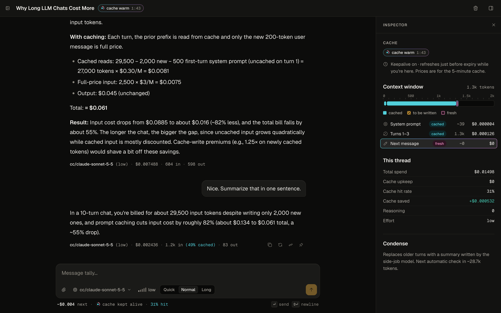
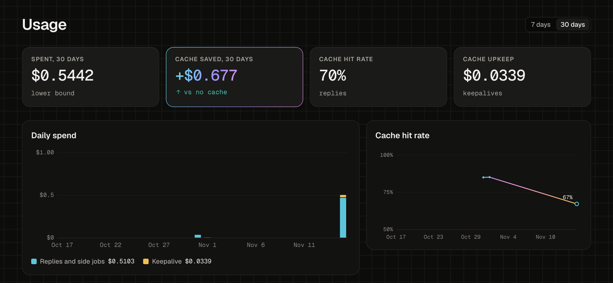
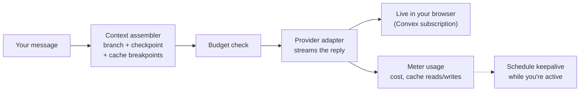

<div align="center">


# tally.chat

### Your chat history is the bill.<br/>tally.chat caches it, keeps it warm, and shows you every cent.

An open-source, self-hosted chat app for your own API keys.<br/>
Chat with any model and see what every turn costs, before and after you send.

[](LICENSE)
[](https://convex.dev)
[](https://nextjs.org)
[](https://bun.sh)
[](#development)

[**Quick start**](#quick-start) · [**Features**](#features) · [**How it works**](#how-it-works) · [**Self-hosting guide**](docs/self-hosting.md) · [**Design doc**](docs/tallychat-design-doc.md)

<br/>

<picture>
  <source media="(prefers-color-scheme: dark)" srcset="docs/screenshots/thread-dark.png" />
  <source media="(prefers-color-scheme: light)" srcset="docs/screenshots/thread-light.png" />
  
</picture>

<sub>A real thread on Claude Sonnet 5.5. Every reply shows its cost; the inspector shows what's cached, what's fresh, and what your next message will cost.</sub>

</div>

<br/>

## Stop paying for the same history twice

LLM APIs are stateless. Every message you send resends the **entire conversation** before it, so cost grows quadratically:

> A 10-turn chat often costs **30 to 50×** a single turn, and what you actually typed is **1 to 2%** of the tokens you pay for.

Providers offer a fix, the **prompt cache**, which bills repeated history at a fraction of the price (0.05× on Claude Sonnet and Opus 5.5). But a cache only helps if every request is built to hit it, and it expires after 5 minutes. Read a long answer for six minutes and your next message pays full price for the whole thread again.

Most chat apps show you a token count. **tally.chat is built around the cache:**

<table>
<tr>
<td width="33%" valign="top">

**🧱 Built to hit it**<br/>
Every request is laid out from most stable to most volatile, so the provider reuses the longest possible prefix.

</td>
<td width="33%" valign="top">

**🔥 Kept warm**<br/>
While you're still in the thread, a tiny keepalive refreshes the cache just before it expires.

</td>
<td width="33%" valign="top">

**🧾 Shown to you**<br/>
What's in the context window, what's cached, and what every reply cost, down to the fraction of a cent.

</td>
</tr>
</table>

## Features

### 🧾 See the bill

- **Inspector**: your context window layer by layer (system prompt, summary, turns, next message), each marked cached, to-be-written or fresh, with its price.
- **Cost strip**: `~$0.004 next · cache kept alive · 87% hit` under the composer, updating as you type.
- **Per-reply metadata**: `Sonnet 5.5 (low) · $0.0043 · 12.4k in (87% cached) · 340 out`. Click it for the full breakdown of that turn.
- **Usage page**: 30 days of spend by day and by model, cache hit rate, keepalive spend, and net savings from caching (which can go negative, and tally.chat will tell you).
- **Soft daily budget**: a warning at 80%, a pause at 100%, with an override for the day.

<picture>
  <source media="(prefers-color-scheme: dark)" srcset="docs/screenshots/usage-dark.png" />
  <source media="(prefers-color-scheme: light)" srcset="docs/screenshots/usage-light.png" />
  
</picture>

### 💸 Pay less per token

- **Cache-aware requests**: the system prompt and the summary layer get explicit cache breakpoints, and automatic caching slides over the rest, so the cached part grows every turn.
- **Keepalive**: while you're in a thread, a no-output request refreshes the cache just before it expires. It stops 30 minutes after you leave, never runs twice across tabs, and is metered like everything else.
- **Cache-break warnings**: editing an old message costs more than continuing; tally.chat says how much before you do it.
- **Effort control**: pick how hard the model thinks per thread, and change it per message without losing the cache on models that support it.
- **Output modes**: quick, normal or long replies, with Continue when a reply hits its limit.
- **Cheaper replies**: send one message, or retry one reply, on another model, with what it would cost on each of your models side by side. The thread keeps its model and its warm cache; a new thread with a simple first question suggests a cheaper start.
- **Background condenser**: long threads fold older turns into a summary on your cheap side-job model, but only when the cache math says it pays off (a condense rewrites the cached prefix). Pin anything that must stay word for word, or condense by hand from the inspector.

### 🔐 Own everything

- **Bring your own keys**: Anthropic natively, plus anything OpenAI-compatible: OpenAI, OpenRouter, DeepSeek, Groq, Ollama, LM Studio, vLLM, or a local proxy.
- **Self-hosted and single-user**: your keys are encrypted at rest and never leave your server. A URL guard blocks private addresses unless you allowlist them.
- **Branching that's free**: every message is an immutable node in a tree. Retry, edit and fork without rewriting history, so the cached prefix stays byte-identical.
- **Images**, resized in the browser to what the model can actually read, then priced in the inspector before you send.
- **Import your history** from a ChatGPT or Claude data export, branches and dates included. Imported messages never count as spend.
- **Full-text search** over titles and messages, **installable as an app**, light and dark themes.

## How it works



Requests are ordered from most stable to most volatile, so the provider can reuse the longest possible prefix:

| Layer | Changes when | Cache |
|---|---|---|
| System prompt | its version is bumped | explicit breakpoint |
| Checkpoint summary + pinned messages | the thread is condensed | explicit breakpoint |
| Turns since the checkpoint | never (append-only) | automatic, slides forward each turn |
| Your new message | every turn | fresh |

The full reasoning is in the [design doc](docs/tallychat-design-doc.md), with the irreversible decisions recorded as [ADRs](docs/adr/).

## Quick start

You need [Docker](https://docs.docker.com/get-docker/) with Compose, and an API key from a provider (or a local model server such as Ollama).

```bash
git clone https://github.com/YungBenn/tally-chat.git
cd tally-chat
docker compose up -d
```

The first run builds the app, starts a pinned Convex backend and generates every secret for you. Open http://127.0.0.1:3000, set your password, add a provider on the Providers page, and start a thread.

> [!IMPORTANT]
> Back up `selfhost/secrets/` along with your data: it holds the key that encrypts your provider keys. `./selfhost/backup.sh` saves both.

The [self-hosting guide](docs/self-hosting.md) covers local models (Ollama, LM Studio), HTTPS behind a reverse proxy, backups and restores, upgrades and the smoke check.

> [!NOTE]
> **Subscriptions are not API keys.** A ChatGPT Plus or Claude Pro subscription doesn't grant API access; API usage is billed separately from the provider's developer console.

## Roadmap

| Phase | What | |
|---|---|---|
| 1 | Message tree, metering, providers, encrypted keys, URL guard | ✅ |
| 2 | Cache-aware prefix and keepalive | ✅ |
| 3 | Inspector, cost strip, usage page, soft budget | ✅ |
| 4 | Effort, output modes, images, title search, installable app | ✅ |
| 5 | Self-host packaging: Docker Compose and a setup guide | ✅ |
| 6 | Background condenser, vetoed when it would break the cache | ✅ |
| 7 | Cheaper replies, model suggestions, full-text search, chat import | ✅ |
| 8 | Redesign on the tally.chat design system: holo lines, motion, mobile | ✅ |
| 9 | Documents, Gemini, tools | next |

## Development

You need [Bun](https://bun.sh) 1.4 or later.

```bash
bun install
bun run dev
```

The first run sets up a local Convex backend (choose to run it locally without an account) and the auth keys. Its first deploy then fails on a missing `TALLY_MASTER_KEY`, the key that encrypts provider keys. Set it from a second terminal, then restart `bun run dev`:

```bash
bunx convex env set TALLY_MASTER_KEY "$(openssl rand -base64 32)"
```

Then open http://localhost:3000.

```bash
bun run dev        # Convex + Next.js
bun run test       # Vitest + convex-test
bun run typecheck
bun run lint
```

Tests exercise public Convex functions with a fake provider at the HTTP boundary and assert on what the provider actually received, down to the bytes that decide whether the cache hits. Specs for each phase live in [`docs/specs/`](docs/specs/), and the vocabulary is in [`GLOSSARY.md`](GLOSSARY.md).

**Stack:** [Convex](https://convex.dev) (database, functions, streaming, scheduling) · [Next.js](https://nextjs.org) · [Tailwind CSS](https://tailwindcss.com) · [Vercel AI SDK](https://sdk.vercel.ai) for OpenAI-compatible providers · a hand-written Anthropic adapter for caching, effort and keepalive.

## Contributing

Issues and pull requests are welcome. Before a larger change, read the spec for the area you're touching and the [ADRs](docs/adr/): the message tree is append-only by design, and anything that changes request bytes changes what the cache can reuse.

## License

[MIT](LICENSE) © 2026 Ruben Adisuryo
