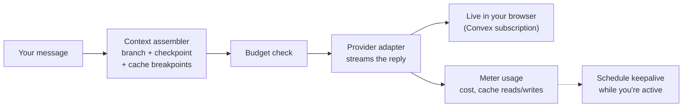

<div align="center">


# tally.chat

**Chat with any model. See what every turn costs.**

The open-source chat app that builds your history around the prompt cache,
keeps that cache warm while you read, and shows you exactly what you're paying for.

[](LICENSE)
[](https://convex.dev)
[](https://nextjs.org)
[](https://bun.sh)
[](#development)

</div>

---

## Your chat history is the bill

LLM APIs are stateless. Every message you send resends the **entire conversation** before it, so cost grows quadratically: a 10-turn chat often costs 30 to 50 times a single turn, and what you actually typed is 1 to 2% of the tokens you pay for.

Providers offer a fix, the **prompt cache**, which bills repeated history at a fraction of the price (0.05× on Claude Sonnet and Opus 5.5). But a cache only helps if every request is built to hit it, and it expires after 5 minutes. Read a long answer for six minutes and your next message pays full price for the whole thread again.

Most chat apps show you a token count. **tally.chat is built around the cache**: it lays out every request so the provider can reuse it, keeps it warm while you're still in the thread, and shows you what's in the context window, what's cached, and what every reply cost, before and after you send.

```
CONTEXT WINDOW
  system prompt            ~39   cached     $0.000004
  turns 1–14             9.6k    cached     $0.000963
  next message            ~21    fresh      $0.000042

THIS THREAD
  total                                     $0.1820
  cache upkeep                              $0.0030
  cache hit rate                                87%
  cache saved                               $1.24
```
<sub>The inspector, next to every thread.</sub>

## Features

### See the bill
- **Inspector**: your context window layer by layer (system prompt, summary, turns, next message), each marked cached, to-be-written or fresh, with its price.
- **Cost strip**: `~$0.004 next · cache warm · 87% hit` under the composer, updating as you type.
- **Per-reply metadata**: `Sonnet 5.5 (low) · $0.0043 · 12.4k in (87% cached) · 340 out`. Click it for the full breakdown of that turn.
- **Usage page**: 30 days of spend by day and by model, cache hit rate, keepalive spend, and net savings from caching (which can go negative, and tally.chat will tell you).
- **Soft daily budget**: a warning at 80%, a pause at 100%, with an override for the day.

### Pay less per token
- **Cache-aware requests**: the system prompt and the summary layer get explicit cache breakpoints, and automatic caching slides over the rest, so the cached part grows every turn.
- **Keepalive**: while you're in a thread, a no-output request refreshes the cache just before it expires. It stops 30 minutes after you leave, never runs twice across tabs, and is metered like everything else.
- **Cache-break warnings**: editing an old message costs more than continuing; tally.chat says how much before you do it.
- **Effort control**: pick how hard the model thinks per thread, and change it per message without losing the cache on models that support it.
- **Output modes**: quick, normal or long replies, with Continue when a reply hits its limit.

### Own everything
- **Bring your own keys**: Anthropic natively, plus anything OpenAI-compatible: OpenAI, OpenRouter, DeepSeek, Groq, Ollama, LM Studio, vLLM, or a local proxy.
- **Self-hosted and single-user**: your keys are encrypted at rest and never leave your server. A URL guard blocks private addresses unless you allowlist them.
- **Branching that's free**: every message is an immutable node in a tree. Retry, edit and fork without rewriting history, so the cached prefix stays byte-identical.
- **Images**, resized in the browser to what the model can actually read, then priced in the inspector before you send.
- **Title search**, **installable as an app**, light and dark themes.

## How it works



Requests are ordered from most stable to most volatile, so the provider can reuse the longest possible prefix:

| Layer | Changes when | Cache |
|---|---|---|
| System prompt | its version is bumped | explicit breakpoint |
| Checkpoint summary + pinned messages | the thread is condensed | explicit breakpoint |
| Turns since the checkpoint | never (append-only) | automatic, slides forward each turn |
| Your new message | every turn | fresh |

The full reasoning is in the [design doc](docs/tallychat-design-doc.md), with the irreversible decisions recorded as [ADRs](docs/adr/).

## Quick start

> **Status:** tally.chat runs today as a local, single-user app. One-command Docker self-hosting is next on the roadmap.

You need [Bun](https://bun.sh) 1.4 or later and an API key from a provider (or a local model server such as Ollama).

```bash
git clone https://github.com/YungBenn/tally-chat.git
cd tally-chat
bun install
bun run dev
```

The first run sets up a local Convex backend (choose to run it locally without an account) and the auth keys. Its first deploy then fails on a missing `TALLY_MASTER_KEY`, the key that encrypts your provider keys. Set it from a second terminal, then restart `bun run dev`:

```bash
bunx convex env set TALLY_MASTER_KEY "$(openssl rand -base64 32)"
```

Back that value up somewhere safe: losing it makes stored provider keys unreadable.

Open http://localhost:3000, set your password, add a provider on the Providers page, and start a thread.

> **Subscriptions are not API keys.** A ChatGPT Plus or Claude Pro subscription doesn't grant API access; API usage is billed separately from the provider's developer console.

## Roadmap

| Phase | What | |
|---|---|---|
| 1 | Message tree, metering, providers, encrypted keys, URL guard | ✅ |
| 2 | Cache-aware prefix and keepalive | ✅ |
| 3 | Inspector, cost strip, usage page, soft budget | ✅ |
| 4 | Effort, output modes, images, title search, installable app | ✅ |
| 5 | Self-host packaging: Docker Compose and a setup guide | next |
| 6 | Background condenser, vetoed when it would break the cache | |
| 7 | Model suggestions, documents, Gemini, chat import, full-text search | |

## Development

```bash
bun run dev        # Convex + Next.js
bun run test       # Vitest + convex-test (190 tests)
bun run typecheck
bun run lint
```

Tests exercise public Convex functions with a fake provider at the HTTP boundary and assert on what the provider actually received, down to the bytes that decide whether the cache hits. Specs for each phase live in [`docs/specs/`](docs/specs/), and the vocabulary is in [`GLOSSARY.md`](GLOSSARY.md).

**Stack:** [Convex](https://convex.dev) (database, functions, streaming, scheduling) · [Next.js](https://nextjs.org) · [Tailwind CSS](https://tailwindcss.com) · [Vercel AI SDK](https://sdk.vercel.ai) for OpenAI-compatible providers · a hand-written Anthropic adapter for caching, effort and keepalive.

## Contributing

Issues and pull requests are welcome. Before a larger change, read the spec for the area you're touching and the [ADRs](docs/adr/): the message tree is append-only by design, and anything that changes request bytes changes what the cache can reuse.

## License

[MIT](LICENSE) © 2026 Ruben Adisuryo
