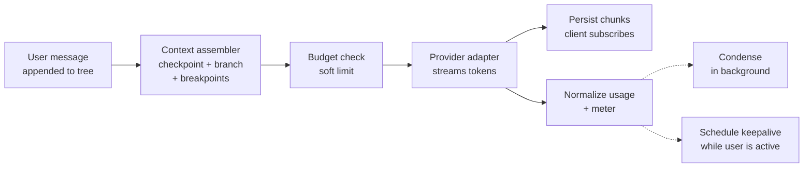
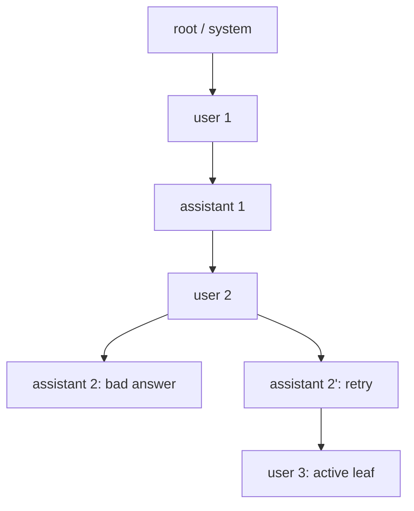
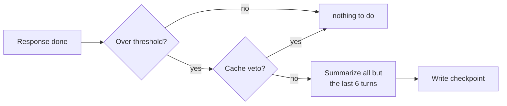

# tally.chat: Design Doc

Sep 25, 2026 · revised Oct 31, 2026 · @Ruben Adisuryo

tally.chat is a multi-provider chat app that wins on cost transparency: cache-aware history, a visible context window, and live token metering. Open source, and every user brings their own provider keys. Phases 1 to 4 in section 9 deliver most of the savings for roughly 20% of the work.

Terms used here are defined in [`GLOSSARY.md`](../GLOSSARY.md). Irreversible decisions are recorded in [`docs/adr/`](./adr/).

## 1. Premise

A multi-model, multi-provider chat app whose differentiator is token efficiency and transparency, not model coverage.

The pitch: build history around the prompt cache, show the user why each turn costs what it does, and spend less doing it. Same spirit as pi.dev for coding agents, applied to chat.

**Reference points**

- **T3 Chat** for feature shape: branching conversations, resumable streams, cross-device sync, one interface across providers. Worth noting the path Theo took: OpenRouter + Redis, then PlanetScale, then Convex. The boring stack was tried first and abandoned.
- **pi.dev** for philosophy: minimal harness, tiny system prompt, session tree with fork, automatic compaction, BYOK, no hidden context injection.

**What does not transfer from pi.dev.** Pi attacks system-prompt and tool-definition bloat because that is where coding-agent tokens go. In chat the system prompt is already small. The bloat sits elsewhere, which is section 2.

## 2. The problem, in numbers

LLM APIs are stateless, so every turn resends the whole conversation. Cost grows quadratically, not linearly.

| Finding                                                                                                  | Source                                                                                                    |
| -------------------------------------------------------------------------------------------------------- | --------------------------------------------------------------------------------------------------------- |
| A 10-turn conversation often costs 30 to 50x a single turn, not 10x                                      | [Kifox](https://kifox.ai/en/what-does-an-llm-api-call-really-cost-tokens-caching-and-batch-explained-en/) |
| Full-context 50-query conversation used 55x the input tokens of no context; last-1 context was only 3x   | [LLMBridge (arXiv 2410.11857)](https://arxiv.org/pdf/2410.11857)                                          |
| The user's typed message is typically 5 to 10% of actual input tokens                                    | [Kontinuity](https://kontinuity.space/blog/ai-model-cost-comparison)                                      |
| Measured Claude sessions: \~5,000 tokens constant system overhead; each user message is 1 to 2% of total | [IntuitionLabs](https://intuitionlabs.ai/articles/token-optimization-chatgpt-claude-costs)                |
| Reasoning tokens outnumber visible output 5x to 20x on hard queries                                      | [TokenKarma](https://tokenkarma.app/blog/ai-token-pricing-what-you-pay-per-query/)                        |
| Two near-identical workloads at 91.8% vs 3.2% cache hit rate: roughly 60x cost difference                | [ProjectDiscovery](https://projectdiscovery.io/blog/how-we-cut-llm-cost-with-prompt-caching)              |
| Async condensation cut history tokens up to 72% on 10-turn chats, 41% average                            | [MT-OSC (arXiv 2604.08782)](https://arxiv.org/pdf/2604.08782)                                             |
| A practitioner eval saw summarizing drop recall from \~95% to 32% and double cost by breaking the cache  | [Louis Bouchard](https://www.louisbouchard.ai/context-engineering-2026/) (blog-level, indicative)         |

The headline: what the user types is 1 to 2% of the bill. Everything else is machinery, so optimizing the machinery is the product.

One quality caveat from LLMBridge: zero context scores worst, and the gap widens most in the tail 20% of a conversation. Naive truncation is not the answer. Smart eviction is, and even that is lossy, which is why condensing stays conservative (S3).

## 3. Cost drivers, ranked

1. **Conversation accumulation:** quadratic, dominant over everything else.
2. **Reasoning tokens:** invisible to the user, billed at output rates. Overspend concentrates on easy queries.
3. **Output tokens:** 4 to 5x the price of input, and every answer becomes history for later turns.
4. **System prompt:** 500 to 3,500 tokens, charged on every single turn.
5. **Attachments and tool results:** a doc uploaded at turn 2 bills through turn 50. A web search appends \~2,000 tokens.
6. **Dead context:** topic drift inside one long thread.

## 4. Request pipeline

Every user message flows through the stages below. Metering and condensing never block the user, which is load-bearing.



There is no automatic router on this path. Model is fixed per thread unless the user changes it, with the cost shown first (S6), and effort defaults per thread with a manual per-turn override where the model allows it without cache loss (S7). The only per-turn model switch is the user's manual cheaper-reply button, and the inspector shows its cache cost before they click.

**Streaming in Convex.** The provider call runs in a Convex action, and an action cannot stream to the browser directly. Instead the action writes the growing answer to the message document in buffered chunks (flush every \~100 ms, never per token, or mutation count explodes), and the client subscribes to that document. This also gives resumable streams for free: close the tab, reopen, and the subscription picks up where the document is. Use the `persistent-text-streaming` component for this rather than writing our own.

## 5. Group A: send fewer tokens

### S1. Append-only message tree

The foundation. Every other feature reads from it. Recorded in [ADR 0001](./adr/0001-append-only-message-tree.md).

```
messages: {
  _id, threadId, parentId,   // one node per message
  ancestorIds,               // root..parent, so a branch is one read
  role,                      // user | assistant | system
  pinned,                    // never condensed
  content, tokens, model, createdAt
}                            // never mutated after write

checkpoints: {
  _id, threadId,
  coversUpToId,              // last message folded into the summary
  summary, tokens, createdAt
}

threads: {
  _id, ownerId, activeLeafId,
  systemPromptVersion, modelId, effort
}
```

Never store a flat conversation array. A thread points at a leaf; to build a request, walk `parentId` up to root and reverse. That branch is the context.



Walking up from user 3 skips the bad answer entirely. It stays in storage, never in a request.

Three features fall out free: forking is a new child on an older parent, a retry is a sibling assistant message under the same user message, and editing a past user message is a fork (a sibling user message, with a "2 of 2 versions" switcher in the UI). Since no message ever mutates, prefixes stay byte-stable for caching.

**No single-message delete or drop.** A message is made unreachable by forking around it, never deleted or skipped. Dropping a message mid-history would need an exclusion list or a copy-fork, and either one costs a full cache rebuild the user does not see coming. Revisit if users ask for it. Deleting a whole thread is a hard delete of its messages, checkpoints and attachments; cost rollups keep its spend so daily totals still add up.

**Why summaries live in a separate table.** Writing a summary into the chain would mean editing old messages' parents or flags, which breaks append-only. A checkpoint instead points at the last message it covers. The assembler walks up from the leaf and, at the first message covered by a checkpoint, swaps everything above it for the summary. A fork made before the checkpoint never reaches it, so checkpoints are branch-safe with no extra logic.

**Checkpoints roll.** Each new checkpoint summarizes the previous summary plus the next turns, so the assembler only ever applies the latest checkpoint on the branch. Pinned messages inside a covered range are emitted verbatim right after the summary, in their original order, never moved to the top.

**Walking without N reads.** Walking up `parentId` costs one read per ancestor. Each message instead stores `ancestorIds`, so building a branch is one read. Chosen over caching the built branch by leaf id because the denormalized field is the one that cannot be added cheaply later; chats stay far below document size limits at realistic lengths.

### S2. Fork instead of continue

Bad answer at turn 12? Write the next user message as a child of turn 11.

Architecturally this is nothing new: S1 plus a UI affordance plus `activeLeafId`. Without it, one garbage response rides along in every future request for the life of the thread. Cheapest win on the list.

The inspector says what a fork or edit costs: editing the user message at turn 3 discards the cache from turn 3 on.

### S3. Background condenser



Messages are never touched. The checkpoint row is the only write, and the UI can still show the original turns behind an expandable fold.

Critically, this runs after the response, never in the request path. MT-OSC confirmed the condenser's own token cost is well covered by the savings as threads grow. On Convex this is a scheduled function triggered by the mutation that writes the assistant message.

**Trigger.** Condense when the verbatim turns since the last checkpoint exceed **30k tokens**, folding everything except the **last 6 turns**. Never condense a thread under **10k tokens** total. These are settings, not constants, tuned from cache metrics. The inspector shows the next condense point ("condenses in \~8k tokens").

**Who summarizes depends on the adapter.** Condensing is an adapter capability, and both paths write the same checkpoint:

- **anthropic:** Anthropic's on-demand compaction (beta `compact-2026-09-04`), run in the background with recent turns kept verbatim and our own summary prompt. It also handles preserved thinking: on 5.x models, rewriting earlier turns ourselves invalidates replayed thinking blocks, and accounts created on or after 2026-08-31 get a 400. A `cache_control` on the returned compaction block sets the breakpoint after the summary. Images and documents inside the summarized range are lost, which pinned messages and the fold mitigate. If the beta goes away, fall back to the side-job path.
- **openai-compatible:** a side-job summary on the user's cheap model.

**Tuning.** Large infrequent batches, never small frequent trims. The reason is S5.

**Quality check.** Summaries lose detail. Pinned messages are never condensed, the fold stays expandable, and a periodic eval should ask the model a fact from a condensed turn to catch drift before users do.

### S4. Lazy attachments

**Images** go inline from phase 4 on vision models, with no lazy logic. The inspector shows their token cost, and adding one invalidates the messages cache after it.

**Documents** (PDFs and the like) wait for this item. Do not inline them. Store the file, extract a summary plus chunk embeddings, put only the summary in context, and rehydrate chunks on demand when a turn semantically hits them.

This converts a permanent per-turn tax into an on-demand fetch.

Tool results will follow the same rule once tools exist (not in v1, see section 9). A web search result (\~2,000 tokens) is needed for the turn that asked for it, not for the 30 turns after. Store the raw result and keep only a short digest in context afterwards.

## 6. Group B: pay less per token

### S5. Cache-aware prefix construction

The highest-leverage item on the list. This is where the 60x lives.

Providers cache a prefix, and any byte change invalidates everything after it. So order context by volatility, most stable first.

| Layer                                                 | Changes when                | Cache point                                              |
| ----------------------------------------------------- | --------------------------- | -------------------------------------------------------- |
| System prompt                                         | `systemPromptVersion` bumps | Explicit breakpoint 1                                    |
| Latest checkpoint summary + pinned messages it covers | The condenser runs          | Explicit breakpoint 2                                    |
| Verbatim turns since the checkpoint                   | Never, append-only          | Automatic caching moves the breakpoint forward each turn |
| Current user message                                  | Every turn                  | Not cached                                               |

**The sliding window comes free.** Automatic caching (a top-level `cache_control: {type: "ephemeral"}`) places the breakpoint on the last cacheable block and moves it forward every request, and the 20-block lookback finds the previous turn's write because a chat turn adds only a few blocks. That is the sliding window ProjectDiscovery built by hand to reach 90%+ hit rates. Explicit breakpoints are needed only for the two stable layers above it.

**Architecture.** The assembler emits the message array, two explicit breakpoints (end of system prompt, end of checkpoint layer), and turns on automatic caching for the rest. Automatic caching takes one of the 4 allowed breakpoints, so that is 3 of 4 with one spare. Store `systemPromptVersion` on the thread so a prompt edit is a deliberate, visible invalidation rather than a silent accident.

**Cache mechanics that shape the design** (Claude API, per [Anthropic's prompt caching docs](https://platform.claude.com/docs/en/build-with-claude/prompt-caching) and [pricing](https://platform.claude.com/docs/en/about-claude/pricing), checked Oct 31, 2026):

- Default lifetime is 5 minutes, counted from the start of the request, and refreshed free on every hit. A 1-hour lifetime is available.
- Writes cost 1.25x base input (2x for 1-hour). Reads cost 0.05x on Opus 5.5 and Sonnet 5.5, 0.025x on Fable 5.1, and 0.1x on Haiku 5.5 and older models. A cache that writes more than it reads loses money.
- Max 4 breakpoints per request, and each looks back only 20 blocks for a prior write. A run of consecutive tool_use or tool_result blocks counts as one position.
- Minimum cacheable prefix is 512 tokens on every 5.x model, up to 4,096 on older ones. Short chats never cache at all.
- What invalidates: tool definitions invalidate everything; web-search, citations or speed toggles invalidate system and messages; tool_choice and images invalidate messages; a top-level thinking or effort change invalidates messages (and on some models, tools and system too).
- A `max_tokens: 0` request warms the cache without generating output. It is rejected with `stream: true`, structured outputs, forced tool_choice, extended thinking, or inside Batches, and it needs an explicit breakpoint rather than automatic caching.

**Reasoning compounds on newer Claude models.** On Opus 4.5+, Sonnet 4.6+ and Haiku 5.5, earlier thinking blocks stay in context by default and count as input when read from cache. Reasoning there is not a one-turn cost: it rides along in history, cheaply as cache reads, but it keeps growing the prefix. On 5.x models those blocks are also why we never rewrite history ourselves on Anthropic (S3). One more reason S7 defaults thinking off.

**Chat-specific trap: human think time.** Agents fire requests seconds apart; people pause. A user who spends 6 minutes reading a long answer comes back to a cold 5-minute cache.

**Keepalive, then the 1-hour lifetime.** While a thread is open and the user is active (tab focused or typing), send a `max_tokens: 0` keepalive just before the 5-minute window closes. Each keepalive is a cache read, so six per hour cost about 0.3x the prefix on Opus or Sonnet 5.5, against a 2x write for the 1-hour lifetime, and they stop when the user leaves.

- Stop after about 30 minutes without activity.
- Only one keepalive runs per thread, deduped server-side across tabs and devices.
- Keepalive spend is its own inspector line ("cache upkeep \$0.003"), and the user can turn keepalive off in settings.
- Fall back to the 1-hour lifetime for threads with extended thinking on (where `max_tokens: 0` is rejected) or when keepalive is off, once a thread is long enough that a cold re-read costs more than the 2x write premium. Short threads keep the 5-minute lifetime.

**Provider note.** The lifetime and write premium above are Anthropic's rules. Others differ, so track cache hit rate per provider and let the inspector say when a provider is not caching:

| Provider      | Caching                                                    | Read cost             | Write cost              | Usage fields                                                       |
| ------------- | ---------------------------------------------------------- | --------------------- | ----------------------- | ------------------------------------------------------------------ |
| OpenAI        | Automatic, 1,024-token minimum                             | 0.1x (0.05x on GPT-6.1) | 1.25x (30m), 2.5x (12h) | `input_tokens_details.cached_tokens`, `cache_write_tokens`        |
| Gemini        | Implicit on 2.5+; explicit not supported on Gemini 4 Argon+ | 90 to 95% off         | Storage fee if explicit | `cachedContentTokenCount`, `thoughtsTokenCount`                    |
| DeepSeek      | Automatic, cleared after hours to days                     | \~2 to 3% of a miss   | None                    | `prompt_cache_hit_tokens`, `prompt_cache_miss_tokens`              |
| Groq          | Automatic, gpt-oss models only, \~2h                       | 50% off               | None                    | `prompt_tokens_details.cached_tokens`                              |
| OpenRouter    | Passes through the upstream provider                       | Upstream              | Upstream                | `cached_tokens`, `cache_write_tokens`, `cost`                      |

Sources: [OpenAI](https://developers.openai.com/api/docs/guides/prompt-caching), [Gemini](https://ai.google.dev/gemini-api/docs/caching), [DeepSeek](https://api-docs.deepseek.com/guides/kv_cache), [Groq](https://console.groq.com/docs/prompt-caching), [OpenRouter](https://openrouter.ai/docs/guides/best-practices/prompt-caching). OpenRouter's own per-provider caching table disagrees with the providers' docs; trust the providers.

**The core tension: S3 fights S5.** Every condense rewrites the middle of the prefix and invalidates the cache below it. Four rules resolve it:

- Condense rarely, in large chunks
- Condense immediately after a response, so the next request pays the cold cost once
- Never let condensation touch the system prompt layer
- Track cache hit rate as a first-class metric and let it veto a condense

Getting this interaction right is the hard, interesting, defensible part. No competitor documents doing it.

### S6. Model choice, not auto routing

No automatic turn-by-turn routing in v1. The thread's model only changes when the user changes it, and the picker shows what the switch discards before they do (section 12). A model switch throws away that model's cache, so in a long, active thread routing an easy turn to a smaller model costs about 4x more than staying put (Claude API list prices, 50k-token thread), and more now that cache reads are 0.05x on the 5.5 models. The one case where routing wins, an expired cache, is better fixed by keepalive and the 1-hour lifetime in S5. Silent switches also hurt quality and work against a product pitched on user control.

Three cheap features keep the savings and leave the user in charge:

- **Side jobs on a cheap model.** The user sets one side-job model; titles and non-Anthropic condensing always go there. This is where most routing savings actually live.
- **Model suggestion at thread start.** "This looks simple, start on Haiku?" A new thread has no cache to lose, so switching there is free.
- **Manual "cheaper reply" button.** The inspector shows the estimated cost of each model for this turn, including cache warmth, and the user picks. The cost math becomes visible, which is on brand.

**Revisit with data.** Track how often an easy-looking turn lands on an expired cache. If that turns out to be common, automatic routing can come back with numbers behind it.

### S7. Reasoning budget control

Reasoning tokens bill at output rates and are invisible. Default extended thinking off, suggest it at thread start when the opening message looks hard, and expose effort as a user control with live cost display. Nothing switches automatically.

**Cache conflict.** Changing the top-level thinking or effort setting invalidates the messages cache, so the default is set per thread. On models that accept a per-message effort system message (beta `mid-conversation-output-config-2026-07-01`: Opus 5.5, Sonnet 5.5, Haiku 5.5, Fable 5.1), the user can also change effort for a single turn with the cache intact. On other models the per-turn control is hidden, and the inspector warns before a thread-level change.

Read `reasoning_tokens` from the usage block on every response and store it on the message separately from `outputTokens`. You cannot manage what you do not record.

Documented case: a pipeline burning \~8,000 reasoning tokens per 300-token response saved $200/month by dropping effort, with no measurable quality loss.

### S11. Output budget

Covers cost driver 3. Output costs 4 to 5x input, and every answer becomes history that later turns re-read.

Default to a concise answer style in the system prompt, set `max_tokens` per mode (quick, normal, long), and let the user ask for more with one tap. A shorter answer saves twice: once now, and again on every later turn in the thread.

## 7. Group C: the product layer

### S8. Semantic cache (dropped from v1)

The idea: embed each question, and when a new one is close enough to a past one, return the stored answer without calling a model.

Dropped because chat answers depend on context too much for "similar text, same answer" to be safe. "What should I do next?" in a trip thread and in a code thread look almost identical but need different answers, and "is it fixed now?" asked twice in one thread should get a different answer the second time. A wrong cached answer costs more trust than the tokens it saves. Payoff is high for repetitive support bots, not exploratory chat.

### S9. Context inspector

This is the wedge. Others now show token counts: LibreChat has a context gauge with a cached breakdown, Chatbox shows context usage and cached tokens, LobeHub shows cache savings. None of them explains or protects the cache.

```
CONTEXT WINDOW
  system                    412 tok    cached
  summary of turns 1-8    1,240 tok    cached
  turns 9-14              6,830 tok    cached
  turns 15-16             1,100 tok     fresh

  this turn                          $0.0043
  cache upkeep                       $0.0030
  thread total                       $0.1820
  cache hit rate                          87%
  reasoning tokens                      1,430
  next condense                  in ~8k tok
```

The assembler already computes all of this to build the request, so returning it alongside is near-zero extra work.

**Cache-break warnings.** Before any action that invalidates the cache, the inspector says what it will cost: editing a past message, switching model, changing thread-level effort, adding an image, condensing now.

Pair it with manual controls: pin a message so it never condenses, condense now, fork here.

This is pi.dev's "you control what enters the context window," translated to chat.

### S10. Metering

Every response writes `inputTokens` (always uncached input), `cacheReadTokens`, `cacheWriteTokens5m`, `cacheWriteTokens1h`, `outputTokens`, `reasoningTokens`, `model`, `provider` and `costMicroUsd` to the message, plus rollups per user per day per model. Keepalive requests are metered the same way, tagged as upkeep.

**Rollups on `@convex-dev/aggregate`.** Convex has no `GROUP BY`; the aggregate component gives O(log n) sums by namespace, kept in sync by triggers. The rollup dimensions still have to be decided up front. Adding one later means backfilling.

With BYOK the provider bills the user directly, so these numbers drive display and soft budgets, not billing. Cost comes from the price table (section 10), except on OpenRouter, which returns `usage.cost` per request and is used as-is.

Split cached tokens into reads and writes, and writes by lifetime. Writes cost 1.25x base input for 5 minutes and 2x for 1 hour, so tracking only one number hides a cache that is losing money and misprices the 1-hour fallback.

Cost is stored as integer micro-dollars (`costMicroUsd`), so rollups summing thousands of sub-cent amounts never drift from float error. Display converts at render time.

`inputTokens` always means uncached input. Adapters subtract cached tokens where a provider's prompt count includes them (OpenAI-style) and pass through where it excludes them (Anthropic), so totals add up across providers.

**Metrics to watch**

| Metric                                     | Why it matters                                |
| ------------------------------------------ | --------------------------------------------- |
| Cache hit rate (read tokens / total input) | Proves S5 works; vetoes S3                    |
| Input tokens per turn at turn 20           | Shows whether history growth is under control |
| Cost per 1,000 messages                    | The number the pitch rests on                 |
| Reasoning share of output                  | Catches thinking left on for easy turns       |
| Condensations vetoed                       | Shows S3 and S5 negotiating                   |
| Keepalive spend vs cold re-reads avoided   | Proves keepalive pays for itself              |

## 8. What must be right

Four decisions, ranked by how badly they hurt if wrong.

### 8.1 The message tree schema

The only truly irreversible decision. Every other feature reads from it. Settled in [ADR 0001](./adr/0001-append-only-message-tree.md): one message per node (a retry is a sibling assistant message, an edit is a fork), checkpoints stored outside the chain, and no single-message delete.

How to walk without N reads is settled too: `ancestorIds` on every message (S1).

Test: sketch the query for "render turn 40 of a thread condensed twice and forked once." If the sketch is ugly, the schema is wrong.

### 8.2 Metering dimensions

Second irreversible thing, because of Convex specifically. Adding a dimension later means backfilling every historical message.

Decide now: per user, per day, per model, per provider, per thread. Include `cacheReadTokens`, `cacheWriteTokens5m`, `cacheWriteTokens1h` and `reasoningTokens` as separate fields from day one, with cost in integer micro-dollars. Skip the cache fields and you cannot measure whether S5 works, which makes S5 unbuildable.

### 8.3 The cache-vs-condense tension

The hard part, and the part that is actually novel. Everything else here is known technique.

The trap: the condenser looks like it is saving tokens while quietly destroying cache hit rate, so the bill goes up. Invisible without instrumentation.

**Rule: do not ship S3 until cache hit rate is a live metric.** Order matters more here than anywhere else.

### 8.4 Whether Convex is right

Settled in [ADR 0002](./adr/0002-convex-backend.md): yes. Branching, resumable streams and cross-device sync are its sweet spot and they are this app's features. Its weakest area for this product, metering rollups, is covered by `@convex-dev/aggregate`. Self-hosting is Docker Compose with SQLite by default.

Remaining risks: Convex Cloud bills function wall-time, which long LLM actions use a lot of (self-hosters avoid this, a public instance would not); and self-host support is community-only.

## 9. Build order

| Phase | Items                                                                                                                                                                                                                                                  | Why here                                                                   |
| ----- | ------------------------------------------------------------------------------------------------------------------------------------------------------------------------------------------------------------------------------------------------------ | -------------------------------------------------------------------------- |
| 1     | S1 message tree, S10 metering on `aggregate`, provider layer (hand-written anthropic adapter, AI SDK for openai-compatible, encrypted keys, SSRF guard with private-host allowlist), price table sync, plus a one-day spike running Convex self-hosted in Docker | Everything depends on these, and key handling is not something to retrofit |
| 2     | S5 cache-aware prefix + keepalive                                                                                                                                                                                                                      | Biggest single win                                                         |
| 3     | S9 context inspector with cache-break warnings, `/usage` page                                                                                                                                                                                                       | Nearly free once S5 exists, and it is the differentiator                   |
| 4     | S2 fork, edit and retry; S7 effort (per thread + per turn); S11 output budget; inline images; thread title search; PWA                                                                                                                                 | Cheap, high value, each item small                                         |
| 5     | Self-host packaging: Docker Compose, setup guide, README                                                                                                                                                                                               | Needed before announcing; install friction kills open-source adoption      |
| 6     | S3 condenser (Anthropic compaction + side-job summary for others)                                                                                                                                                                                      | Only after cache metrics exist, or damage goes unnoticed                   |
| 7     | S6 model suggestion + cheaper-reply button, S4 documents, gemini adapter, import from ChatGPT/Claude exports, full-text message search, tools (web search)                                                                                              | Deferrable                                                                 |

Phases 1 to 4 are roughly 20% of the work and most of the savings.

**Not in v1:** tool use, including web search; S4's tool-result digest rule stays as a design constraint for when tools arrive. Full-text message search waits for phase 7 to keep the search-index path (the T3 outage path) small. Native mobile apps are out of scope; the web app ships as a PWA.

Deliberately not worried about yet: streaming UX polish. The provider layer is real work, scoped in section 10.

## 10. Stack

| Layer     | Choice                                   | Reasoning                                                                                                                                                                    |
| --------- | ---------------------------------------- | ---------------------------------------------------------------------------------------------------------------------------------------------------------------------------- |
| Backend   | Convex                                   | Branching, resumable streams and cross-device sync are its sweet spot. T3 Chat landed here after Redis then PlanetScale. Open source with Docker self-hosting. See ADR 0002 |
| Components| `persistent-text-streaming`, `aggregate` | Streaming and metering rollups. Not the Agent component: its own thread and message model would fight the message tree                                                       |
| Frontend  | Next.js, installable as a PWA            | Standard, matches the public reference implementations                                                                                                                       |
| Auth      | Single-user login                        | One password set at install, so strangers cannot spend your keys if the instance is online. No accounts, no paid auth service                                                |
| Providers | Direct provider APIs, bring your own key | User adds a provider with base URL, API key and API style. The inspector shows the user's real bill                                                                          |
| Vector    | Convex built-in                          | For S4 document chunks, no separate service                                                                                                                                  |

**Convex risks going in**

- Lock-in is real: the data access layer is not portable.
- Rollup dimensions are chosen up front, even with the aggregate component.
- Pricing is compute-based on function wall-time, and long LLM actions are exactly that shape. Model the volume before committing to a public instance.
- Read the [June 2025 postmortem](https://news.convex.dev/how-convex-took-down-t3-chat-june-1-2025-postmortem/) of the T3 Chat outage. Search index compaction invalidated thousands of subscribed queries at once, clients reconnected without backing off, and tooling cut hardware mid-incident. T3 Chat was unusable for nearly 3 hours. Relevant here because chat history search uses the same text-search path, which is why v1 searches titles only.

### Provider layer: bring your own key

Users connect their own providers, so the project never pays for inference. Each user pays their provider directly, and the context inspector shows exactly what that bill is made of. Every token the context engine saves is money back in the user's pocket, which is the whole pitch.

```
providers: {
  _id,
  ownerId,          // always the single user in v1; kept for future multi-user
  name,             // "My Anthropic", "Home Ollama"
  apiStyle,         // anthropic | openai-compatible | gemini
  baseUrl,          // https://api.anthropic.com, http://localhost:11434, ...
  apiKeyEncrypted,
  models,           // pulled from /v1/models, user can edit
  capabilities      // caching mode, reasoning, vision, tools, server compaction, per-turn effort
}

settings: { ownerId, sideJobModelId, dailySoftBudgetUsd, keepaliveEnabled }
```

**Single-user in v1.** One instance, one person. No sign-up, no accounts, no shared providers. Every table still carries `ownerId` (threads, messages, providers, settings), always set to that one user, so adding accounts later is a feature rather than a migration of every record. Multi-user is planned for after v1.

**Three adapters cover almost everything.** Start with the first two.

| Adapter           | Covers                                                                                                                 | Built with                                                                                                                                   | Caching                                                     |
| ----------------- | ---------------------------------------------------------------------------------------------------------------------- | -------------------------------------------------------------------------------------------------------------------------------------------- | ----------------------------------------------------------- |
| openai-compatible | OpenAI, DeepSeek, Groq, Together, Mistral, local servers (Ollama, LM Studio, vLLM), even OpenRouter if a user wants it | Vercel AI SDK. It maps cache reads and reasoning tokens but leaves cache writes undefined, so read `usage.raw` for `cache_write_tokens` and OpenRouter's `cost` | Automatic where the provider supports it; nothing to send   |
| anthropic         | Claude models                                                                                                          | Hand-written against the raw API, because automatic caching, compaction and the per-turn effort beta all live here and the SDK does not document them | Explicit breakpoints + automatic caching, so most of S5 lives here |
| gemini            | Google models                                                                                                          | Later                                                                                                                                        | Implicit; add later                                         |

Caching support varies by provider and changes over time. Store it as a capability flag per provider, confirmed from the response usage fields, never assumed.

**Normalize usage.** Every provider reports cache and reasoning tokens in different fields (section 6, provider note). The adapter maps them to one shape (input, cache read, cache write, output, reasoning) before S10 ever sees them.

**Price table: sync, do not hand-maintain.** A script vendors LiteLLM's MIT-licensed `model_prices_and_context_window.json`, which carries 5-minute and 1-hour cache write prices (models.dev lacks the 1-hour price, which keepalive math needs). A small local overrides file covers custom endpoints and local models at $0. OpenRouter requests use the returned `usage.cost` instead of the table.

**Security: user-supplied URLs are the main risk.**

- SSRF: the server will fetch any URL a user types. By default allow https only, resolve DNS and block private, loopback and link-local ranges (including the cloud metadata address 169.254.169.254), and re-check after redirects. The owner can allowlist specific private hosts in settings, which is how a self-hoster reaches Ollama on the same machine or LAN.
- Keys: encrypt at rest with the master key in an environment variable, never in the database, decrypt only inside the action that calls the provider, never send a key back to the client, never log request headers.
- Test a key with one cheap call on save, and show which provider a key belongs to without ever showing the key.

**Local models.** On a self-hosted instance, Ollama on the same machine or LAN works through the allowlist above. Only a public instance cannot reach a user's own laptop; there, browser-direct calls or a tunnel are the options.

**Subscriptions are not API keys.** A ChatGPT Plus or Claude Pro subscription does not grant API access; API usage is billed separately from the provider's developer console. Say this in onboarding, or users will expect their existing subscription to work.

**Spend control.** No middleman means no hard caps to provision. Offer an in-app soft budget (warn, then block, per day) from S10 metering; the hard cap is whatever the user sets in their provider console.

### Open source

No pricing plan, no billing, no paid tiers. The project's value to users is the token savings on their own bills.

**What open source changes in the stack.** Self-hosters run whatever you pick, so the stack has to be easy to stand up.

- Convex's backend is open source with Docker Compose self-hosting (SQLite by default, Postgres or MySQL optional), but its self-host tooling is newer than the cloud product and support is community-only. Test the full self-host path early.
- Single-user with one install-time password keeps auth out of the self-host story entirely.
- Ship a one-command setup (Docker Compose) and a short self-hosting guide. Most open-source chat apps win or lose adoption on install friction.
- Keys stay on the self-hoster's own server, which is a selling point: say so in the README.

**License: MIT.** Chosen for maximum adoption: anyone can use, modify or sell it, as long as the copyright notice stays. The accepted tradeoff is that a hosted fork can keep its changes closed. Add the LICENSE file in the first commit, before accepting outside contributions.

## 11. Positioning and open questions

Not "another ChatGPT clone with more models," and no longer "the only app that shows tokens" either: LibreChat, Chatbox and LobeHub show counts. The line is: the only chat app that builds history around the cache and shows you why each turn costs what it does.

Three things no competitor documents shipping: cache-aware history construction (prefix layering, keepalive, cache-vetoed condensing), an inspector that warns before an action breaks the cache, and reasoning off by default with effort the user controls per turn where the model allows it.

**Open questions**

- Self-host only, or also run a public demo instance? A public instance would need accounts, abuse limits, Convex Cloud cost, and browser-direct calls for local models, so it depends on multi-user first.

## 12. UI/UX

**Who it is for.** Technical power users: people who already hold API keys and can run Docker. The UI is keyboard-first and frank about tokens and dollars, dense in the cost layer and calm in the conversation. Non-technical users come later, with multi-user.

**Visual direction.** Modeled on claude.ai's look and feel, as inspiration only: no Claude or Anthropic name, logo, or brand colors.

- Warm neutral palette (ivory-ish light theme, warm charcoal dark theme) with one warm accent of our own. Color beyond that only where it means something (cache warm, keepalive, cold, over budget).
- A centered, roomy reading column; a serif-leaning typeface for assistant answers, a clean sans for UI.
- Composer as a rounded card pinned to the bottom of the column; quiet, collapsible sidebar.
- The cost layer is the deliberate contrast: metadata lines, cost strip and inspector are dense, in monospace with tabular numerals. Conversation reads calm, numbers read precise.

No receipt or ledger skeuomorphism. Tailwind + shadcn/ui, light and dark themes following the system.

**Layout.**

- Desktop: three columns. Thread list on the left (collapsible), chat in the center, inspector as a collapsible right rail, closed by default and remembered per device.
- Mobile: installable PWA. The thread list is a drawer; the inspector is a bottom sheet opened from the cost strip.

**Cost strip.** One line under the composer, always visible: `~$0.004 next · cache warm · 87% hit`. The estimate updates live while typing (debounced, local tokenizer, prefixed `~`); the provider's count-tokens endpoint is not called per keystroke. Clicking the strip opens the inspector.

**Per-message metadata.** Every assistant message carries a muted line, always visible: `Sonnet 5.5 · $0.0043 · 12.4k in (87% cached) · 340 out · 1.4k reasoning`. Clicking it opens that turn in the inspector. While a reply streams, the line shows a live output-token counter only; cost and cache figures appear once the real usage block lands, never estimated mid-stream.

**Cache status.** A chip in the thread header shows one of `warm` (expiry countdown in the tooltip), `keepalive` (subtle pulse) or `cold`, and links to the inspector line that explains why.

**Savings.** The inspector's thread total and the `/usage` page show net savings from caching ("cache saved $1.24 this week"): read discount minus write premium minus keepalive spend. It is allowed to go negative.

**Cache-break hints.** Inline and non-blocking, at the point of action: "breaks cache · +$0.04" beside Edit, the model picker and the effort toggle. No modals, except a confirmation when the extra cost exceeds a user threshold (default $0.10). The model picker stays usable on an existing thread, with the hint showing what the switch discards.

**Branches.** A `‹ 2/3 ›` switcher on any message that has siblings from a retry or edit. No tree view in v1; a minimap in the inspector can come later.

**Condensed history.** Condensed turns collapse into one bar: `Turns 1-8 summarized · 1,240 tok · view summary · expand`. Expanding shows the originals greyed and labeled "not in context". Pinned messages inside the range stay visible at full contrast.

**First run.** Four steps: set the password; add a provider (paste a key, a test call validates it and shows which provider it belongs to, plus the "subscriptions are not API keys" note); pick a default model and a side-job model (the side-job model alone is skippable and defaults to the provider's cheapest); land in an empty thread.

**Usage page.** `/usage`, built in phase 3 next to the inspector: daily spend over 30 days, per-model breakdown, cache hit rate trend, keepalive spend, and soft-budget progress.

**Soft budget.** A dismissible banner at 80% of the daily budget. At 100%, sending is blocked with an "override for today" button, and side jobs and keepalive pause silently.

**Money.** USD only in v1, matching provider bills. Per-turn amounts show 4 significant digits ($0.0043); totals of $1 or more show 2 decimals. A display currency (for example IDR, at a user-entered fixed rate) can come later.

**Keyboard.**

| Key                    | Action                                            |
| ---------------------- | ------------------------------------------------- |
| `⌘K`                   | Command palette: threads, models, actions         |
| `⌘I`                   | Toggle inspector                                  |
| `⌘⇧O`                  | New thread                                        |
| `↑` in empty composer  | Edit last message, with the cache hint            |
| `Enter` / `⇧Enter`     | Send / new line                                   |

**Accessibility.** Muted metadata still meets WCAG AA contrast in both themes. Cache states always pair color with a label or icon. Every control is keyboard reachable, and streaming text is announced politely to screen readers.

**Before phase 3.** Build a throwaway prototype of chat, cost strip and inspector with fake data, and check density at desktop and phone widths.

## 13. Sources

- [Anthropic: prompt caching docs](https://platform.claude.com/docs/en/build-with-claude/prompt-caching)
- [Anthropic: pricing](https://platform.claude.com/docs/en/about-claude/pricing)
- [Anthropic: on-demand compaction](https://platform.claude.com/docs/en/build-with-claude/compaction-on-demand)
- [Anthropic: preserved thinking](https://platform.claude.com/docs/en/build-with-claude/preserved-thinking)
- [Anthropic: change effort mid-conversation](https://platform.claude.com/docs/en/build-with-claude/effort#change-effort-mid-conversation-beta)
- [Anthropic: effective context engineering for AI agents](https://www.anthropic.com/engineering/effective-context-engineering-for-ai-agents)
- [OpenAI: prompt caching](https://developers.openai.com/api/docs/guides/prompt-caching)
- [Gemini: context caching](https://ai.google.dev/gemini-api/docs/caching)
- [DeepSeek: KV cache](https://api-docs.deepseek.com/guides/kv_cache)
- [Groq: prompt caching](https://console.groq.com/docs/prompt-caching)
- [OpenRouter: usage accounting](https://openrouter.ai/docs/guides/guides/usage-accounting)
- [Vercel AI SDK: OpenAI-compatible usage mapping](https://github.com/vercel/ai/blob/main/packages/openai-compatible/src/chat/convert-openai-compatible-chat-usage.ts)
- [Convex: persistent-text-streaming](https://github.com/get-convex/persistent-text-streaming)
- [Convex: aggregate](https://github.com/get-convex/aggregate)
- [Convex: self-hosting](https://github.com/get-convex/convex-backend/blob/main/self-hosted/README.md)
- [Convex: how Convex took down T3 Chat, June 1, 2025 postmortem](https://news.convex.dev/how-convex-took-down-t3-chat-june-1-2025-postmortem/)
- [LiteLLM: license](https://github.com/BerriAI/litellm/blob/main/LICENSE)
- [LibreChat: token usage](https://www.librechat.ai/docs/configuration/token_usage)
- [Chatbox: changelog](https://chatboxai.app/en/help-center/changelog)
- [LLMBridge: cost reduction for LLM access (arXiv 2410.11857)](https://arxiv.org/pdf/2410.11857)
- [MT-OSC: multi-turn context condensation (arXiv 2604.08782)](https://arxiv.org/pdf/2604.08782)
- [Prefix-aware parallel compaction (arXiv 2605.23296)](https://arxiv.org/abs/2605.23296v1)
- [ProjectDiscovery: how we cut LLM cost with prompt caching](https://projectdiscovery.io/blog/how-we-cut-llm-cost-with-prompt-caching)
- [Louis Bouchard: context engineering in 2026](https://www.louisbouchard.ai/context-engineering-2026/)
- [Kifox: what an LLM API call really costs](https://kifox.ai/en/what-does-an-llm-api-call-really-cost-tokens-caching-and-batch-explained-en/)
- [Augment Code: agent loop token cost and context constraints](https://www.augmentcode.com/guides/ai-agent-loop-token-cost-context-constraints)
- [Flexera: prompt caching breakdown](https://www.flexera.com/blog/ai/prompt-caching-breakdown/)
- [IntuitionLabs: token optimization for ChatGPT and Claude](https://intuitionlabs.ai/articles/token-optimization-chatgpt-claude-costs)
- [TokenKarma: AI token pricing per query](https://tokenkarma.app/blog/ai-token-pricing-what-you-pay-per-query/)
- [AIOutlooks: thinking tokens explained](https://aioutlooks.com/thinking-tokens-explained/)
- [Redis: token-budget-aware LLM reasoning](https://redis.io/blog/token-budget-aware-llm-reasoning/)
- [Finout: OpenAI vs Anthropic API pricing](https://www.finout.io/blog/openai-vs-anthropic-api-pricing-comparison)
- [Nanonets: AI token limits explained](https://nanonets.com/blog/ai-token-limits-explained-claude-context-window/)
- [Kontinuity: AI model cost comparison](https://kontinuity.space/blog/ai-model-cost-comparison)
